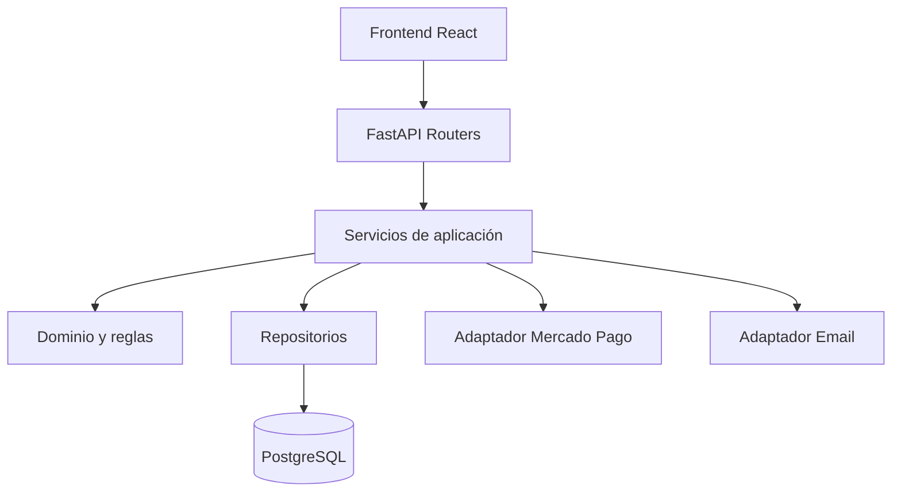

# Arquitectura del backend

> Stack y monolito modular aprobados mediante ADR-001, con implementación inicial de aplicación, core, db y modelos de usuarios. La estructura completa y módulos candidatos siguen siendo propuesta; consultar el avance verificado al final.

## Objetivo
Construir un backend de e-commerce mantenible para cuentas, catálogo, compra, pagos, stock, cursos y administración, con seguridad y trazabilidad.

## Estilo arquitectónico
**Monolito modular con POO y capas ligeras**:
1. **Routers**: transporte HTTP, autenticación de solicitudes, validación de esquemas y códigos de respuesta.
2. **Servicios de aplicación**: coordinación de casos de uso y límites transaccionales.
3. **Dominio**: entidades y reglas de negocio que no dependen de HTTP.
4. **Repositorios**: acceso a datos y consultas encapsuladas.
5. **Infraestructura**: PostgreSQL, Mercado Pago, email, archivos y configuración.



## Módulos candidatos
- `auth`: identidad, sesiones y autorización.
- `catalog`: productos, cursos y consultas públicas.
- `cart`: carrito y validación previa a compra.
- `orders`: pedidos y transiciones de estado.
- `payments`: intenciones, confirmación, reconciliación y webhooks.
- `inventory`: movimientos y consistencia de existencias físicas; cupos de cursos pendientes de validación.
- `courses`: acceso autorizado a contenido.
- `admin`: gestión y auditoría.
- `notifications`: correo transaccional y boletines (alcance por validar).

## Reglas de diseño
- No colocar reglas de precio o stock exclusivamente en React.
- Controlar autorización también en servicios, no solo en routers.
- Servicio de pagos idempotente; no considerar redirección del navegador como prueba de pago.
- Definir transacciones para confirmación de pedido e inventario; elegir estrategia de reserva/descuento en un diseño posterior.
- No guardar secretos ni datos sensibles de pago en Markdown o repositorios.
- No crear abstracciones o herencias sin necesidad concreta; favorecer composición e inyección de dependencias.

## Estructura propuesta
```text
backend/
  app/
    main.py
    core/
    db/
    modules/
      auth/
      catalog/
      cart/
      orders/
      payments/
      inventory/
      courses/
      admin/
  alembic/
  tests/
  pyproject.toml
```
Cada módulo podría incorporar `router.py`, `schemas.py`, `service.py`, `repository.py` y `models.py` si su complejidad lo justifica.

## Dependencias por validar
- Modelos y rutas React actuales.
- Flujos y permisos efectivos exigidos por el cliente.
- Proveedor de correo y política de envío.
- Versiones de Python, librerías y hospedaje.

## Referencias
- [[ADR-001 - Backend y persistencia]]
- [[Modelo de dominio - borrador]]
- [[Contradicciones y decisiones pendientes]]
- [FR](<../../FRs/functional-requirements.md>)
- [NFR](<../../NFRs/Non-functional-requirements.md>)

## Diseño complementario
- [[Capas del backend]]
- [[ADR-002 - Modelo lógico relacional v0.1]]
- [[Modelo lógico relacional v0.1]]
- [[Reglas del backend]]

## Estado contrastado con código — 2026-10-21

La estructura real contiene app/main.py, core/config.py, core/exceptions.py, db/base.py, db/session.py y modules/users/models.py, además de Alembic y tests. Solo GET /health es ruta funcional implementada; no verifica conexión a BD. Los módulos candidatos y capas de negocio no están completos.

Véase [[Registro de avances]] para evidencia, diferencias y límites de la validación.
