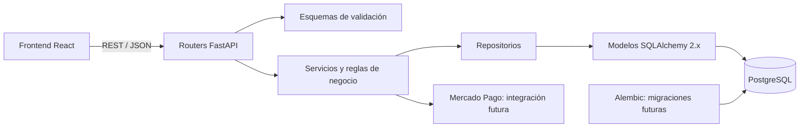

# Arquitectura del backend

**Estado: stack aprobado; implementación parcial de la base técnica.** Referencia: 14 de octubre de 2026.

La decisión normativa de stack está en [ADR-001](<ADR/ADR-001 - Backend y persistencia.md>). Se propone organizar el monolito por identidad, catálogo, compras, pagos, inventario y cursos, manteniendo responsabilidades separadas dentro de cada módulo. Email, boletines, administración y visualización operativa siguen siendo requisitos; su diseño detallado no está cubierto aún.

El diagrama expresa responsabilidades propuestas, no componentes implementados. Los servicios delimitarán transacciones para pedidos, reservas, movimientos y confirmaciones. Las llamadas externas no sustituyen las garantías de la base de datos; se deberá diseñar recuperación y conciliación ante fallas.

React presenta la interfaz y solicita operaciones; el backend valida permisos, propiedad de recursos, disponibilidad e importes. La redirección del navegador después del checkout no confirma un pago.

Consultar [modelo lógico](<Database/Modelo lógico relacional v0.1.md>), [reglas por módulo](<Reglas del backend.md>), [pendientes](<../Management/Diferencias y decisiones pendientes.md>) y [plan de sprints](<../Management/Plan de sprints.md>).

## Estado contrastado con código — 2026-10-21

Hay fábrica FastAPI, configuración, errores, CORS, base/sesiones SQLAlchemy y modelos/migraciones de usuarios/perfiles. Servicios y repositorios de negocio, esquemas de autenticación y Mercado Pago siguen pendientes.

Véase [[Registro de avances]] para evidencia, diferencias y límites de la validación.
