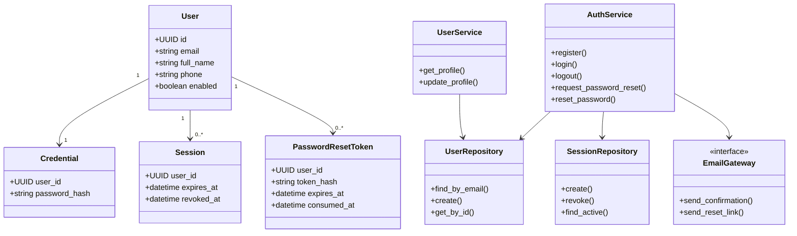

# Modelo de clases — Usuarios y acceso

> **Modelo conceptual propuesto**. No son tablas existentes ni nombres definitivos del repositorio.

## Responsabilidades POO
- **Servicios**: orquestan casos de uso y decisiones transaccionales, no conocen HTTP.
- **Repositorios**: aíslan persistencia y constraints, sin lógica de autorización implícita.
- **Entidades/modelos**: estados y reglas coherentes con FR, separados conceptualmente de esquemas HTTP.
- **Routers**: entradas, dependencias, códigos de error y respuesta.
- **Interfaces/adaptadores**: correo externo desacoplado para facilitar pruebas.

## Integridad
- Email normalizado con unicidad real en la BD, no solo validación previa.
- Identificadores de sesiones/tokens no deben registrarse en texto claro.
- Cambio de contraseña debe invalidar sesiones según la política aprobada.
- Perfil: direcciones, preferencias, boletines e historial se modelarán cuando se inspeccionen requisitos completos y relaciones con otros módulos.

## Pendiente
Tipos, nombres definitivos, cardinalidades reales, migraciones, representación de los roles fijos ADMIN/CLIENT y modelo de correo se aprobarán tras inspección del frontend y requisitos relacionados.

Las sesiones y sus repositorios son condicionales a la estrategia de autenticación pendiente (ADR-003); no implican elección definitiva de almacenamiento. Google OAuth diferido (DEC-02/NFR-39).

## Estado contrastado con código — 2026-10-21

El diagrama sigue conceptual. El código contiene User y ClientProfile; password_hash está en User. Credential, Session, PasswordResetToken, servicios y repositorios del diagrama no existen como implementación. Los nombres del perfil se almacenan separados; el teléfono no está modelado.

Véase [[Registro de avances]] para evidencia, diferencias y límites de la validación.
